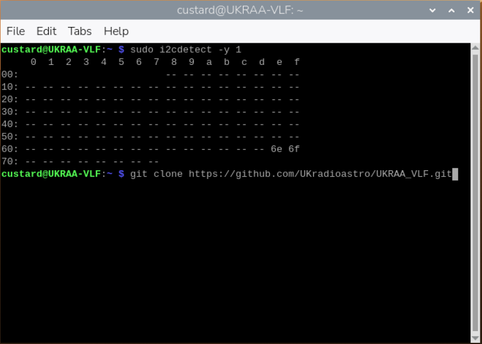
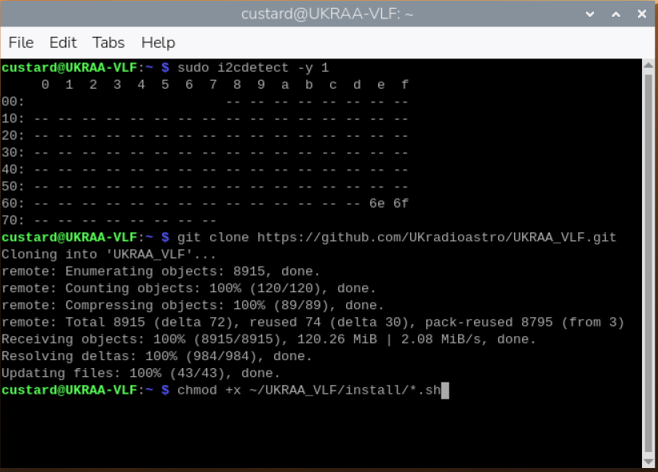
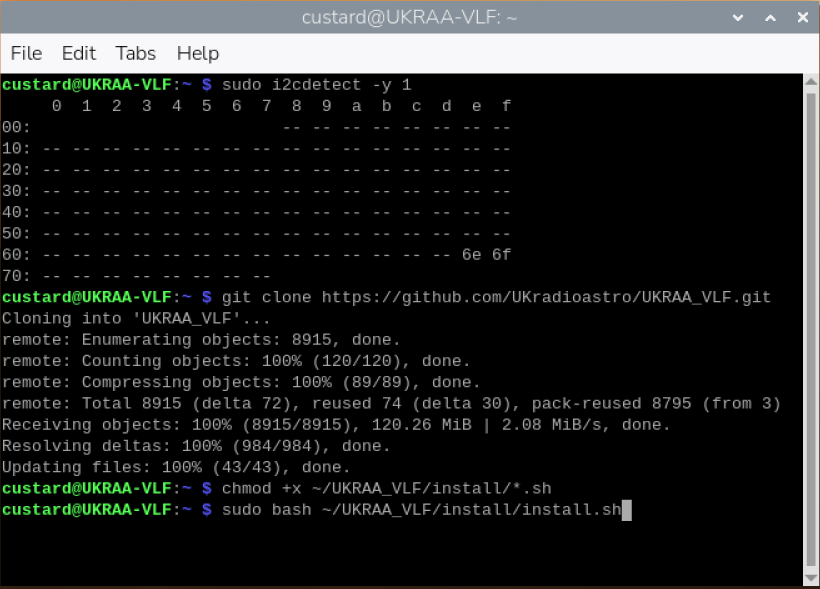
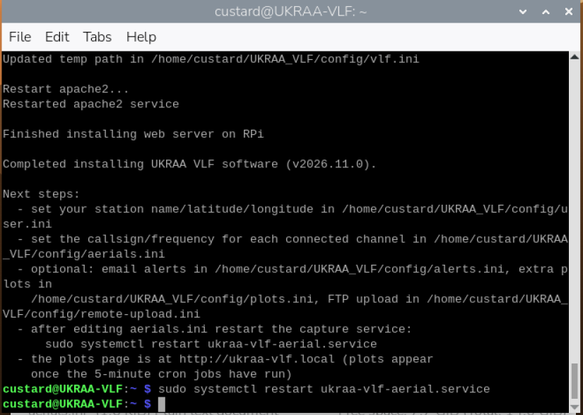
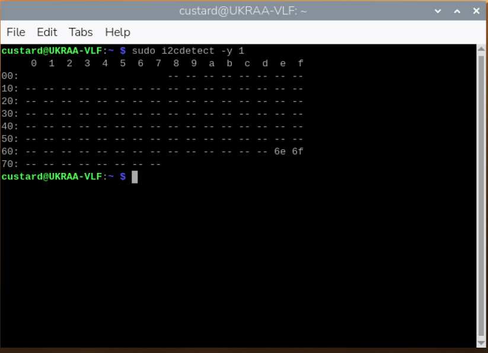
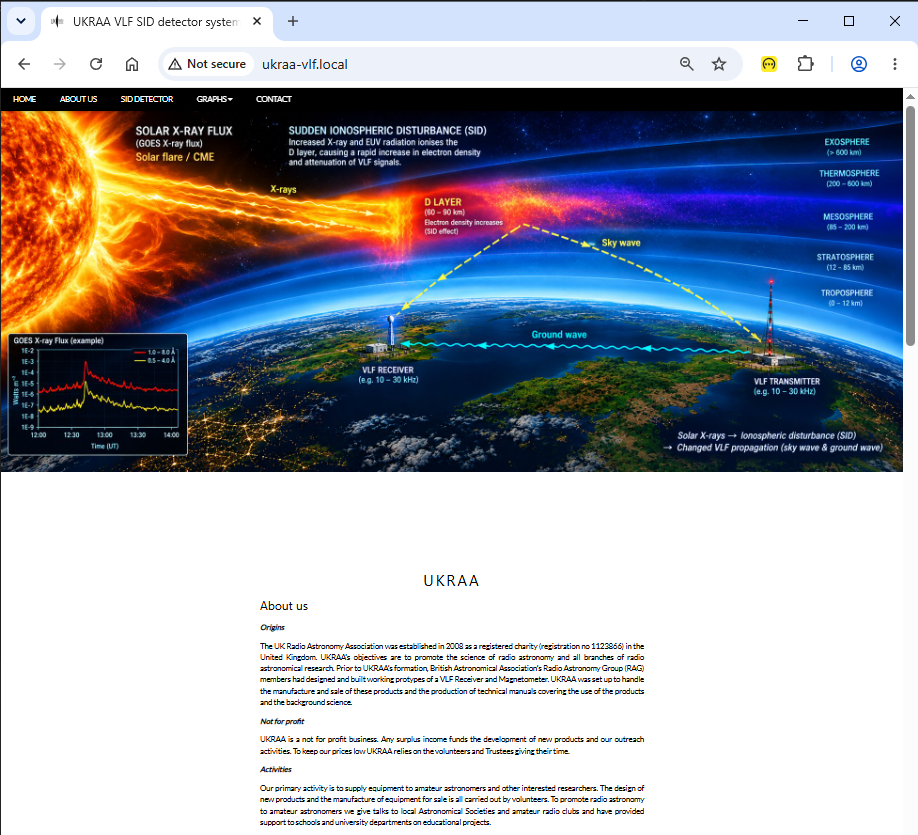
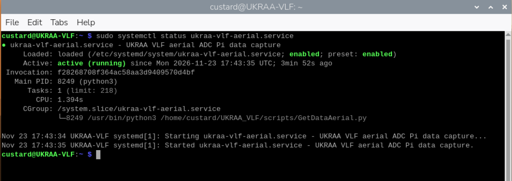

<div align=center>

</div>


# Python code for the UKRAA VLF receiver
[](/LICENSE)
[](https://www.python.org/)
[](https://www.gnu.org/software/bash/)
[](https://www.gnuplot.info/)
[](https://www.raspberrypi.org/)
[](https://www.raspberrypi.com/)

Set of Python, gnuplot and shell scripts to run on a RPi Zero 2 W to record, process and present data from the UKRAA VLF receiver, using the AB Electronics ADC Pi analogue-to-digital converter board.

This software was written to suit a specific set-up; feel free to use as you see fit.

---

&nbsp;
<!-- =============================================================================== -->
## Contents

- [Using the code](#using-the-code)
- [Getting the software onto your RPi](#getting-the-software-onto-your-rpi)
- [Installing the software onto your RPi](#installing-the-software-onto-your-rpi)
- [Check the ADC Pi is detected](#check-the-adc-pi-is-detected)
- [Setting up your station](#setting-up-your-station)
- [What does the code do](#what-does-the-code-do)
- [VLF webpage](#vlf-webpage)
- [Check the VLF aerial service is running](#check-the-vlf-aerial-service-is-running)
- [Optional 3-day and 7-day plots](#optional-3-day-and-7-day-plots)
- [Optional flare alert Emails](#optional-flare-alert-emails)
- [Optional Remote FTP upload](#optional-remote-ftp-upload)
- [Optional BAA SID monthly report](#optional-baa-sid-monthly-report)
- [Updating the software](#updating-the-software)
- [Publishing a release](#publishing-a-release)
- [License](#license)
- [Contact us](#contact-us)

&nbsp;

---

&nbsp;
<!-- =============================================================================== -->
## Using the code

The installer uses the account that invoked `sudo`; the username does not have to be **pi**. Clone into `~/UKRAA_VLF` as that account, then run the installer with `sudo`. Do not run it from a root login unless you set `VLF_FILE_OWNER` to the account that owns the checkout. Moving an existing installation to another account is not supported.

The VLF receiver output voltages are read through the two MCP3424 ADC chips on the AB Electronics ADC Pi board, plugged onto the RPi's GPIO header. The installer enables the I2C interface, detects the chips' I2C addresses (somewhere in the **0x68-0x6F** range, set by the board's address jumpers) and writes them into **config/aerials.ini**.

**GetDataAerial.py** is run as a service (`ukraa-vlf-aerial.service`).

Other scripts (Python and gnuplot) are run from **cron** using shell scripts.

[Back to Contents...](#contents)

&nbsp;

---

&nbsp;
<!-- =============================================================================== -->
## Getting the software onto your RPi

1. Log into your Raspberry Pi Zero 2 W (directly, over SSH or using VNC).

2. Open a terminal window, type the following command and press enter

```
git clone https://github.com/UKradioastro/UKRAA_VLF.git
```



This downloads the code to **UKRAA_VLF** inside your home directory.

[Back to Contents...](#contents)

&nbsp;

---

&nbsp;
<!-- =============================================================================== -->
## Installing the software onto your RPi

1. Open a terminal window and type the following command and press enter
```
chmod +x ~/UKRAA_VLF/install/*.sh
```



This will make the **install.sh** script executable.


2. Type the following command and press enter
```
sudo bash ~/UKRAA_VLF/install/install.sh
```



This will run the install script. The install is fully unattended - no questions are asked - and it is safe to re-run: existing configuration files are kept, and the service and cron entries are simply replaced.

For a direct root session or unattended install, specify the owning account explicitly, for example `sudo VLF_FILE_OWNER=vlfuser bash /home/vlfuser/UKRAA_VLF/install/install.sh`. The installer verifies the checkout belongs to that account. Installation paths may contain only letters, digits, dots, underscores, hyphens and slashes.

The installer:

- installs all dependencies (gnuplot, python3-requests, i2c-tools and the smbus2 module used by the ADC Pi library)
- enables the I2C interface and sets the system timezone to UTC (all data and log timestamps are UTC)
- creates the directory structure, log files and all **config/*.ini** files from the supplied examples
- copies the UKRAA VLF desktop wallpaper to **~/Pictures**, ready to select as your desktop background
- detects the MCP3424 ADC chips on the I2C bus and writes their addresses into **config/aerials.ini**
- installs and starts the aerial capture service (`ukraa-vlf-aerial.service`)
- installs the cron entries into your crontab
- installs the Apache web server and publishes the intranet web page

When the installer finishes it prints a summary of what to set up next:



That's it!

The code is now set up to run automatically; it will record the receiver voltages from the ADC Pi, fetch the NOAA GOES X-ray data, plot the results and post the plots to your intranet web page.

[Back to Contents...](#contents)

&nbsp;

---

&nbsp;
<!-- =============================================================================== -->
## Check the ADC Pi is detected

The installer reports the detected MCP3424 ADC chip addresses while it runs, but you can confirm them yourself at any time.

1. Open a terminal window and type the following command and press enter
```
sudo i2cdetect -y 1
```



&nbsp;

2. You are looking for **two** addresses in the **0x68-0x6F** range (shown as `68` to `6f` in the bottom rows of the grid) - one for each MCP3424 chip on the ADC Pi board.

&nbsp;

3. These are the I2C addresses of your ADC Pi, recorded as **address_1** and **address_2** in **~/UKRAA_VLF/config/aerials.ini**. The positions are set by the address selection sockets on the board - see the **I2C Address Selection** section on the [AB Electronics ADC Pi page](https://www.abelectronics.co.uk/p/69/adc-pi).

&nbsp;

4. If you do not see two addresses, check the ADC Pi is seated squarely on the GPIO header and reboot, then try again.

&nbsp;

[Back to Contents...](#contents)

&nbsp;

---

&nbsp;
<!-- =============================================================================== -->
## Setting up your station

Two configuration files need your details after installing - both live in **~/UKRAA_VLF/config**.

1. **user.ini** - your station name and location (used to fetch sunrise/sunset times for the plot overlays):

```ini
[location]
name = your_location e.g. London
latitude = xx.xxxxx
longitude = xx.xxxxx
```

Latitude/longitude are decimal degrees; North and East are positive, South and West are negative.

2. **aerials.ini** - the transmitter callsign and frequency for each ADC channel with a receiver connected:

```ini
[channel_1]
callsign = DHO38
frequency_hz = 23400
off_air = 07:00-08:00
```

A channel is recorded and plotted only when BOTH **callsign** and **frequency_hz** are set. The optional **off_air** window (UTC) is drawn as an annotation on the plots.

After editing **aerials.ini**, restart the capture service to pick up the changes:

```
sudo systemctl restart ukraa-vlf-aerial.service
```


[Back to Contents...](#contents)

&nbsp;

---

&nbsp;
<!-- =============================================================================== -->
## What does the code do

### Things it does right from the start

The code records the VLF receiver output voltages through the ADC Pi: one measurement cycle every 10 seconds (:00, :10, :20 ... of each minute) on every configured channel, each value being a trimmed mean of multiple ADC readings. One record per channel is appended to that station's daily file under **data/Aerial/**.

Alongside the receiver data, cron jobs fetch:

* NOAA GOES X-ray flux data and X-ray flare events (every 5 minutes)
* sunrise/sunset times for your location (daily)

A number of plots are produced with gnuplot:

* a rolling 24-hour plot per station, refreshed every 5 minutes, with sunrise/sunset shading, the GOES X-ray flux overlay and flare markers - this is where SIDs (Sudden Ionospheric Disturbances) show up against the X-ray record
* yesterday's complete-day plot per station, produced just after midnight UTC

Dated copies of the daily plots are kept in a **plots/** archive.

A simple web server and web page is set up on your RPi, so that you can view your VLF results on your desktop PC and/or smart phone when connected to your home network. To access the webpage, see the [VLF webpage](#vlf-webpage) section for details.

### Things it can do with selectable options

#### 3-day and 7-day plots
There is the option of rolling and complete-days 3-day and 7-day plots per station.

These are configurable through the `plots.ini` file, see the [Optional 3-day and 7-day plots](#optional-3-day-and-7-day-plots) section for details.

#### Email alerts
There is the option of receiving an email alert when a GOES X-ray flare reaches a chosen class (e.g. M1.0), plus an optional daily heartbeat email so you know the system is alive.

These are configurable through the `alerts.ini` file, see the [Optional flare alert Emails](#optional-flare-alert-emails) section for details.

#### Upload, via FTP, to external hosted website
There is the option of uploading all generated plots to an externally hosted webpage.

This is configurable through the `remote-upload.ini` file, see the [Optional Remote FTP upload](#optional-remote-ftp-upload) section for details.

#### BAA SID monthly report
There is the option of automatic detection of candidate SID events (start, peak, end and importance measured from the receiver data around each NOAA flare), with a review workflow and a monthly report for submission to the British Astronomical Association Radio Astronomy Group.

This is configurable through the `baa-report.ini` file, see the [Optional BAA SID monthly report](#optional-baa-sid-monthly-report) section for details.

[Back to Contents...](#contents)

&nbsp;

---

&nbsp;
<!-- =============================================================================== -->
## VLF webpage

To access the VLF webpage on your desktop PC or your smart phone…

1.	Open your preferred web application (Safari, Chrome, Firefox, etc.).

2.	In the address bar, replace `<hostname>` with your Raspberry Pi's hostname and press Enter:
```
http://<hostname>.local
```



This will take you to the web page for your VLF receiver, displaying the rolling 24-hour plots and yesterday's plots for each configured station (plus the 3/7-day plots when enabled).

The plots appear once the 5-minute cron jobs have run after installation. The `.local` address requires working mDNS (such as Avahi on the Pi and mDNS support on the device opening the page); otherwise use the Pi's IP address instead.

Code is also supplied that will enable the user to upload, via FTP, to their own hosted website, should they have one - see the [Optional Remote FTP upload](#optional-remote-ftp-upload) section for details.

[Back to Contents...](#contents)

&nbsp;

---

&nbsp;
<!-- =============================================================================== -->
## Check the VLF aerial service is running

1. To check the **status** of your service, type the following command and press enter.
```
sudo systemctl status ukraa-vlf-aerial.service
```

A **GREEN enabled** and a **GREEN active (running)** indicates the service is running correctly.



&nbsp;

2. To **start** your service, type the following command and press enter.
```
sudo systemctl start ukraa-vlf-aerial.service
```

&nbsp;

3. To **stop** your service, type the following command and press enter.
```
sudo systemctl stop ukraa-vlf-aerial.service
```

&nbsp;

4. To **enable** your service (start automatically at boot), type the following command and press enter.
```
sudo systemctl enable ukraa-vlf-aerial.service
```

&nbsp;

5. To **disable** your service, type the following command and press enter.
```
sudo systemctl disable ukraa-vlf-aerial.service
```

The service restarts itself automatically if the capture process exits or hangs (systemd watchdog), so after a power cut or a wedged I2C bus no manual intervention is needed. An independent cron check (`CheckDataAerial.py`) also reports to **logfiles/logerror.log** if data stops arriving.

[Back to Contents...](#contents)

&nbsp;

---

&nbsp;
<!-- =============================================================================== -->
## Optional 3-day and 7-day plots

Within the **~/UKRAA_VLF/config** folder there is a file named **plots.ini**.

By default only the rolling 24-hour and yesterday plots are produced; the 3-day and 7-day plots are turned off (**false**).

Should the user wish to have the 3-day and/or 7-day plots then change the following in the plots.ini file:

```ini
[3day]
enabled = true

[7day]
enabled = true
```

Each section controls two plots: the rolling 3/7-day plot (refreshed hourly) and the static complete-days 3/7-day plot (midnight to midnight, refreshed daily). Both appear automatically on the webpage when enabled.

Each plot section also has its own overlay switches (all true/false):

* `sun` - sunrise/sunset shading and marks (defaults off on the multi-day plots, which get busy with one night band per day)
* `xray` - NOAA GOES X-ray flux overlay (red, right-hand axis)
* `flares` - solar flare begin/end markers with class labels (defaults off on the 7-day plot, which a week of C-class markers would swamp)

Each section may also set `min_flare_class` - a GOES class string naming the smallest flare to mark, e.g.

```ini
[rolling]
min_flare_class = C1.0
```

hides the B-class markers that make an active day busy. Leave it empty (or omit it) to mark every flare. This only affects the plot markers - the flare alert emails (alerts.ini) and SID event detection (baa-report.ini) have their own thresholds.

[Back to Contents...](#contents)

&nbsp;

---

&nbsp;
<!-- =============================================================================== -->
## Optional flare alert Emails

Within the **~/UKRAA_VLF/config** folder there is a file named **alerts.ini**.

By default email sending is turned off (**false**), so a fresh install does not log SMTP failures.

Should the user wish to receive flare alert emails, fill in the SMTP and recipient settings and then enable email:

```ini
[alerts]
email_enabled = true
flare_threshold = C1.0

[smtp]
host = smtp.example.com
port = 587
username = your-smtp-username
password = your-smtp-password
starttls = true
ssl = false

[email]
from = vlf@example.com
to = you@example.com
attach_plot = false
```

Notes:

* `flare_threshold` is the minimum GOES X-ray flare class that triggers an alert - letter + number, e.g. `C1.0`, `C5.0`, `M1.0`, `X1.0`. The letter sets the decade (A=1e-8, B=1e-7, C=1e-6, M=1e-5, X=1e-4 W/m2) and the number multiplies it, so `M2.5` = 2.5e-5.
* A follow-up email is sent if NOAA later upgrades a flare to a higher class letter (e.g. M -> X).
* `to` takes a comma-separated list for multiple recipients.
* With `attach_plot = true` the current rolling plot (one per configured station) is attached to the email.
* The `[web] url` setting is included as a link in the emails (blank = omitted).

### Optional daily heartbeat email

You can enable a once-per-day summary email so you know the system is alive even when no flare occurs.

In `alerts.ini`:

```ini
[heartbeat]
enabled = true
hour_utc = 9
to =
attach_plot = false
```

Notes:

* `hour_utc` is the first UTC hour of the day when the heartbeat can send.
* Only one heartbeat attempt is made per UTC day (success or failure), to avoid retry spam every 5 minutes.
* If `heartbeat.to` is blank, it uses the `[email] to` list.

### Send a one-off test email

To verify the SMTP settings without waiting for a flare, run:

```
/usr/bin/python3 ~/UKRAA_VLF/scripts/EvaluateAlerts.py --test-email
```

or for the heartbeat email:

```
/usr/bin/python3 ~/UKRAA_VLF/scripts/EvaluateAlerts.py --test-heartbeat
```

The test emails do not update the alert or heartbeat state, so normal alert logic is unaffected.

[Back to Contents...](#contents)

&nbsp;

---

&nbsp;
<!-- =============================================================================== -->
## Optional Remote FTP upload

Within the **~/UKRAA_VLF/config** folder there is a file named **remote-upload.ini**.

By default the option of uploading the plot files is turned off (**false**); while it is off (or the file is absent) the upload cron entries do nothing, so they can stay in place.

Should the user wish to upload the plots from their VLF receiver to an externally hosted webpage, fill in the settings and enable the upload:

```ini
[ftp]
enabled = true
site = ftp.example.com
user = your-ftp-user
password = your-ftp-password
port = 21
directory = /public_html
timeout_seconds = 30
passive = true
create_dirs = true
tls = false
```

Behaviour:

* The rolling 24-hour plots and the `plots.json` manifest are uploaded every 5 minutes; the 3/7-day rolling plots hourly; the yesterday/3-day/7-day complete-days plots daily - each shortly after the matching plot job.
* The remote layout mirrors the local temp folder (`<directory>/temp/...`), so the same **WWW/index.html** works unchanged on the remote site - upload **index.html** and the **WWW/images** folder into `<directory>` once, manually.
* `plots.json` is uploaded last, so the remote page never references an image that is not there yet.
* Set `tls = true` for explicit FTPS (FTP over TLS) if your host supports it - it encrypts the password and the transfers.
* Remote upload failures are non-blocking and do not affect local recording or publishing.

Manual test commands:

```
/usr/bin/python3 ~/UKRAA_VLF/scripts/UploadDataWWW.py rolling
/usr/bin/python3 ~/UKRAA_VLF/scripts/UploadDataWWW.py periods
```

[Back to Contents...](#contents)

&nbsp;

---

&nbsp;
<!-- =============================================================================== -->
## Optional BAA SID monthly report

Within the **~/UKRAA_VLF/config** folder there is a file named **baa-report.ini**.

The British Astronomical Association Radio Astronomy Group (BAA RAG) collects monthly VLF SID (Sudden Ionospheric Disturbance) observations in a five-field table: day, flare class, SID start, peak and end times (UTC) and an importance rating. The software can prepare this report in three stages: automatic daily candidate detection, observer review, and report generation/emailing. Reports are **never sent automatically** - submission is always a deliberate, manual act.

First fill in your details in `baa-report.ini`:

```ini
[observer]
name = Your Name
baa_member_no =
equipment = UKRAA VLF receiver, loop aerial, ADC Pi, Raspberry Pi

[report]
coordinator_email =
cc_self = true
send_enabled = false
```

Your location comes from `user.ini` and the transmitter callsign/frequency from `aerials.ini`, so they are not repeated here. Emailing uses the `[smtp]` server settings in `alerts.ini` (shared with the flare alert emails).

### 1. Automatic candidate detection (daily, from cron)

Each night (00:40 UTC) **ExtractSIDEvents.py** examines yesterday's data for every configured station. Each NOAA GOES X-ray flare that began between sunrise and sunset (and outside the transmitter's off-air window) defines a candidate window, and within it the SID **start, peak and end are measured from the receiver data** - the NOAA times are context only:

* the baseline level and noise come from the quiet period before the flare
* the peak is the largest departure from the baseline, so inverted (negative) SIDs are detected too
* an end that cannot be measured (signal still disturbed at the window end, sunset, the next flare) is recorded as `?` with an unassigned importance of `-` - it is never invented
* the importance rating follows the duration-based SID scale: `1-` under 19 minutes, `1` 19-25, `1+` 26-32, `2` 33-45, `2+` 46-85, `3` 86-125 and `3+` over 125 minutes

Detection sensitivity can be tuned in the `[detection]` section of `baa-report.ini`. Each detected event is appended as a `candidate` row to the monthly candidates file:

```
~/UKRAA_VLF/data/SID_events/<CALLSIGN>/YYYY/YYYY-MM.csv
```

and a review plot of the event (receiver trace, X-ray flux, flare markers and the estimated start/peak/end) is saved to the plots archive (`plots/<CALLSIGN>/events/...`) and to the RPi's web server. The intranet page (`http://<your-pi>.local`) gains a **CANDIDATE SID EVENTS** section - a table per station of the recent events (current and previous month) with their times, importance, review status and a link to each event plot, driven by a `temp/events.json` manifest that is refreshed by the nightly extraction and by `ReportSIDMonth.py`, so your review edits show up on the page. The section (and its navbar entry) stays hidden until there are events.

A day can be reprocessed at any time (reviewed rows are never touched):

```
/usr/bin/python3 ~/UKRAA_VLF/scripts/ExtractSIDEvents.py --date 2026-05-12
```

### 2. Review the month's candidates

Open the monthly candidates CSV in a text editor or spreadsheet, with the **CANDIDATE SID EVENTS** section of the intranet page (or the plots under `temp/events/`) alongside. For each row, compare the automatic estimates (`est_*` columns) with the event plot, then:

* enter corrected times in the `obs_start` / `obs_peak` / `obs_end` columns where needed (leave them blank to accept the estimates; use `?` for an end you cannot measure)
* set `status` to `reviewed` to include the event in the report, or `rejected` to dismiss it (interference, transmitter drop-out, etc.)
* `notes` is yours to use; the `est_*` columns are the original estimates and are kept for traceability

The importance is recalculated from your final start/end times, so you normally leave `obs_importance` blank; fill it in only to override the duration scale.

### 3. Produce (and email) the report

After reviewing, generate the report (by default for last month, one report per configured station):

```
/usr/bin/python3 ~/UKRAA_VLF/scripts/ReportSIDMonth.py
/usr/bin/python3 ~/UKRAA_VLF/scripts/ReportSIDMonth.py --month 2026-05 --callsign DHO38
```

Only `reviewed` rows are included - any rows still in the `candidate` status are listed as a warning and excluded. The report (your observer/station details followed by the day/class/start/peak/end/importance table) is printed to the screen and written to:

```
~/UKRAA_VLF/data/SID_events/<CALLSIGN>/YYYY/BAA_<CALLSIGN>_YYYY-MM.csv
```

A month with no reviewed events still produces a nil return. To email the report CSV directly from the RPi, add:

* `--email-self` - send it to the `[email]` "to" list in `alerts.ini`, e.g. to finish it off on your PC
* `--email` - send it to the `coordinator_email`; as a safety measure this refuses to send until `send_enabled = true` is set in `baa-report.ini`

[Back to Contents...](#contents)

&nbsp;

---

&nbsp;
<!-- =============================================================================== -->
## Updating the software

To update an existing installation to the latest code, pull the new version and re-run the installer:

```
cd ~/UKRAA_VLF
git pull
sudo bash ~/UKRAA_VLF/install/install.sh
```

The installer is safe to re-run: it preserves recorded data, the plot archive, log files and all existing values in your **config/*.ini** files, and simply refreshes the scripts, service, cron entries and web files. Check **CHANGELOG.md** for anything new that needs enabling in the config files.

[Back to Contents...](#contents)

&nbsp;

---

&nbsp;
<!-- =============================================================================== -->
## Publishing a release

For each release, update `VERSION` using the format `YYYY.MM.patch`, update `CHANGELOG.md`, commit the changes, and create a GitHub Release with a tag using exactly the same version, for example `2026.11.0`.

The patch number starts at `0` for the first release in a month and increases for further releases in that month. Use a two-digit month, such as `2026.09.0`, rather than `2026.9.0`.

[Back to Contents...](#contents)

&nbsp;

---

&nbsp;
<!-- =============================================================================== -->
### License

MIT License

Copyright (c) 2026 UKRAA

Permission is hereby granted, free of charge, to any person obtaining a copy
of this software and associated documentation files (the **Software**), to deal
in the Software without restriction, including without limitation the rights
to use, copy, modify, merge, publish, distribute, sublicense, and/or sell
copies of the Software, and to permit persons to whom the Software is
furnished to do so, subject to the following conditions:

The above copyright notice and this permission notice shall be included in all
copies or substantial portions of the Software.

THE SOFTWARE IS PROVIDED **AS IS**, WITHOUT WARRANTY OF ANY KIND, EXPRESS OR
IMPLIED, INCLUDING BUT NOT LIMITED TO THE WARRANTIES OF MERCHANTABILITY,
FITNESS FOR A PARTICULAR PURPOSE AND NONINFRINGEMENT. IN NO EVENT SHALL THE
AUTHORS OR COPYRIGHT HOLDERS BE LIABLE FOR ANY CLAIM, DAMAGES OR OTHER
LIABILITY, WHETHER IN AN ACTION OF CONTRACT, TORT OR OTHERWISE, ARISING FROM,
OUT OF OR IN CONNECTION WITH THE SOFTWARE OR THE USE OR OTHER DEALINGS IN THE
SOFTWARE.

`scripts/ADCPi.py` is the AB Electronics UK ADC Pi library, included under
its own MIT licence - see the notice at the top of that file.

[Back to Contents...](#contents)

&nbsp;

---

&nbsp;
<!-- =============================================================================== -->
### Contact us

Please send an e-mail to vlf@ukraa.com

[Back to Contents...](#contents)

&nbsp;

---
